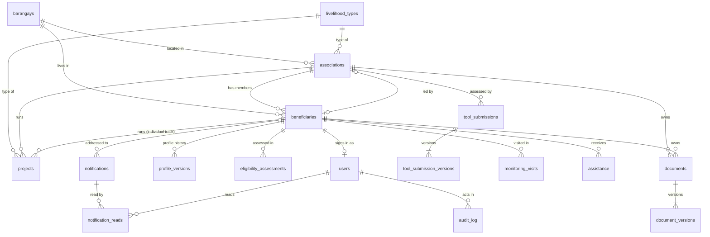

# SLP database schema — design for review

Date: 13 October 2026
Status: draft for review. No database has been created yet.
Target: XAMPP MariaDB 10.4.32, InnoDB, utf8mb4.
Replaces: `database/slp_database.sql` (the old schema has no recipients on notifications, no associations, and links records by name).

---

## 1. The rules this schema enforces

What the MSWDO asked for:

1. **Participant (member)**: reads only. They see what their Association Leader does, including every document the leader sends to the MSWDO. The only thing they can change is their own profile.
2. **Association Leader**: does the association's work. They send documents to the MSWDO and fill in the Annex AA and AC tools.
3. **MSWDO Personnel**: always has the last word. They can edit any record or file at any time.

Decisions made while designing:

| # | Decision |
|---|---|
| D1 | **Every version is kept.** A document, tool form or profile is never overwritten. Each save adds a new, read-only version that records who saved it, when, and (for staff) why. |
| D2 | **The profile is editable until the MSWDO verifies it**: Draft, then Submitted, then Verified. After Verified, only staff can change it, or staff can reopen it. |
| D3 | **Beneficiaries are separated per association.** Lubang has many SLP Associations, each with its own livelihood (for example Poultry, Sari-sari Store, Piggery). A beneficiary belongs to exactly one association, or to none if they are on the individual track. A leader leads one association and must be a member of it. Leaders and members see only their own association's documents, tools and activity. Staff see every association and can filter by one. |
| D3a | **Livelihood types are a list staff manage** (`livelihood_types`), not free text. A new type such as "Piggery" is added once and reused, so reports can count associations per livelihood. |
| D3b | **The 16 barangays of Lubang are a fixed reference table** (`barangays`). Associations and beneficiaries point to it by ID, so a barangay is never misspelled. |
| D3c | **The same livelihood can occur in different barangays, but only once per barangay.** Tilik and Maliig can each have a Poultry association; Tilik cannot have two. This is enforced by `UNIQUE (barangay_id, livelihood_type_id)`. |
| D4 | **The leader role is derived, not stored.** An account is `staff` or `participant`, and the participant who is `associations.leader_id` is the leader. Changing leader means changing one column, with no account edits. |
| D5 | **Records are linked by ID, never by name.** This removes the prototype bugs where editing a name hid the person's own documents and notices. |
| D6 | **Form answers are stored as JSON** (Annex G.1, AA, AC, AF.1). Only the fields used in lists, filters and reports get real columns. A DSWD form revision then needs no database change. |
| D7 | **Once sent, a document is locked for the leader.** The leader can send a new version only when the MSWDO returns the document with a note. |
| D8 | **Nothing is hard-deleted from the app.** Records are deactivated or set to a status instead. Version tables and the audit log reject `UPDATE` and `DELETE` at the database level. |
| D9 | **Files live on disk, outside the web-served area.** The database keeps each file's path plus a SHA-256 hash, so a changed file is detected. |
| D10 | **Members' "what the leader did" view is the audit log**, filtered to their association. There is no separate activity table. |

---

## 2. Who can do what

| Action | Member | Leader | Staff |
|---|---|---|---|
| View own profile and its versions | yes | yes | all profiles |
| Edit own profile (Annex G.1, items 1–24) | while not Verified | while not Verified | any profile, any time, reason required |
| Submit own profile | yes | yes | – |
| Verify or reopen a profile | – | – | yes |
| Eligibility assessment (items 25–29) | view own | view own | write |
| Send a document for the association | – | yes | yes |
| Re-send a returned document (new version) | – | yes | yes |
| Add a version to any document | – | – | yes, reason required |
| Approve or return a document | – | – | yes |
| View the association's documents and their versions | yes | yes | all |
| Fill in AA / AC (draft, submit) | – | yes | edit any, reason required |
| Fill in AF.1 | – | – | yes |
| View the association's **submitted** AA / AC / AF.1 | yes | yes (and own drafts) | all |
| View the association activity feed | yes | yes | all |
| Read notifications addressed to them | yes | yes | all |
| Send notifications | – | – | yes |
| Read reports shared with participants | yes | yes | all |
| Manage associations: create, assign members, name the leader, manage livelihood types | – | – | yes |
| Registry, projects, field monitoring, assistance, accounts, full audit log | – | – | yes |

---

## 3. Approach

The approach is a record table plus a version table, for each kind of record that participants submit:

- `documents` → `document_versions`
- `tool_submissions` → `tool_submission_versions`
- `beneficiaries` (profile record) → `profile_versions`

The current version is the row with the highest `version_no`. To restore an old version, the app adds a new version with the old content, so nothing is rewritten.

Records only staff create (field monitoring, assistance, reports, notifications) are not versioned. Staff edit them directly, and the audit log records each change.

Rejected alternatives:

- **One generic `records` table for everything**: constraints and reports become weak.
- **Every form field as its own column**: that means 400+ columns, and a schema change on every DSWD form revision.

---

## 4. Entity relationships



That is 18 tables, 1 view and 10 triggers.

---

## 5. Schema (DDL for review)

Conventions:
- `INT UNSIGNED` IDs.
- Every table has `created_at`; tables that are edited also have `updated_at`.
- Every `created_by` is a foreign key to `users.id`.
- No `ON DELETE CASCADE` anywhere, because history must never disappear with its parent.
- The app sets `SET time_zone = '+08:00'` on each connection, so `CURRENT_TIMESTAMP` is Philippine time. This also fixes the prototype's UTC date bug.
- Display IDs such as `B-001` are formatted by the app from `id`, so no code columns are stored.
- In MariaDB, `JSON` is `LONGTEXT` with an automatic `JSON_VALID` check.

```sql
CREATE DATABASE IF NOT EXISTS slp_monitoring
  CHARACTER SET utf8mb4 COLLATE utf8mb4_unicode_ci;
USE slp_monitoring;

-- =============================================================
-- People and groups
-- =============================================================

-- The 16 barangays of Lubang (seeded once; names per the DBM barangay list).
CREATE TABLE barangays (
  id           TINYINT UNSIGNED NOT NULL AUTO_INCREMENT,
  name         VARCHAR(60) NOT NULL,
  is_poblacion TINYINT(1) NOT NULL DEFAULT 0,
  PRIMARY KEY (id),
  UNIQUE KEY uq_barangays_name (name)
) ENGINE=InnoDB;

-- Poultry, Sari-sari Store, Piggery, ... Managed by staff. The unicode_ci collation
-- makes the name unique regardless of case, so "piggery" cannot be added twice.
CREATE TABLE livelihood_types (
  id          INT UNSIGNED NOT NULL AUTO_INCREMENT,
  name        VARCHAR(100) NOT NULL,
  status      ENUM('active','inactive') NOT NULL DEFAULT 'active',
  created_at  DATETIME NOT NULL DEFAULT CURRENT_TIMESTAMP,
  PRIMARY KEY (id),
  UNIQUE KEY uq_livelihood_types_name (name)
) ENGINE=InnoDB;

-- One row per SLP Association. Every participant-visible record is scoped to one of these.
CREATE TABLE associations (
  id                  INT UNSIGNED NOT NULL AUTO_INCREMENT,
  name                VARCHAR(150) NOT NULL,     -- e.g. "Tilik Poultry Raisers SLPA"
  livelihood_type_id  INT UNSIGNED NOT NULL,     -- the association's main livelihood
  barangay_id         TINYINT UNSIGNED NOT NULL,
  leader_id           INT UNSIGNED NULL,         -- beneficiaries.id of the current leader
  status              ENUM('active','inactive') NOT NULL DEFAULT 'active',
  created_at          DATETIME NOT NULL DEFAULT CURRENT_TIMESTAMP,
  updated_at          DATETIME NOT NULL DEFAULT CURRENT_TIMESTAMP ON UPDATE CURRENT_TIMESTAMP,
  PRIMARY KEY (id),
  UNIQUE KEY uq_associations_name (name),
  UNIQUE KEY uq_associations_leader (leader_id),                          -- one person leads at most one association
  UNIQUE KEY uq_associations_barangay_type (barangay_id, livelihood_type_id),  -- D3c
  KEY ix_associations_type (livelihood_type_id),
  CONSTRAINT fk_associations_type     FOREIGN KEY (livelihood_type_id) REFERENCES livelihood_types (id),
  CONSTRAINT fk_associations_barangay FOREIGN KEY (barangay_id)        REFERENCES barangays (id)
) ENGINE=InnoDB;

-- The registry row and the profile record in one.
-- The name, sex, birthday, barangay, contact number and participant type columns are
-- copied from the latest profile version in the same transaction. Only non-empty values
-- are copied, so a blank form field never wipes the registry.
CREATE TABLE beneficiaries (
  id                     INT UNSIGNED NOT NULL AUTO_INCREMENT,
  association_id         INT UNSIGNED NULL,          -- NULL = individual track
  first_name             VARCHAR(100) NOT NULL,
  middle_name            VARCHAR(100) NULL,
  last_name              VARCHAR(100) NOT NULL,
  extension_name         VARCHAR(20)  NULL,
  sex                    ENUM('male','female') NULL,
  birthday               DATE NULL,
  barangay_id            TINYINT UNSIGNED NOT NULL,  -- where the person lives
  contact_no             VARCHAR(20)  NULL,
  participant_type       ENUM('4ps','non_4ps') NULL,
  enrollment_status      ENUM('active','for_monitoring','completed','inactive') NOT NULL DEFAULT 'active',
  household_information  TEXT NULL,          -- staff note from the registry form
  profile_status         ENUM('draft','submitted','verified') NOT NULL DEFAULT 'draft',
  created_at             DATETIME NOT NULL DEFAULT CURRENT_TIMESTAMP,
  updated_at             DATETIME NOT NULL DEFAULT CURRENT_TIMESTAMP ON UPDATE CURRENT_TIMESTAMP,
  PRIMARY KEY (id),
  UNIQUE KEY uq_beneficiaries_id_association (id, association_id),  -- target of fk_associations_leader
  KEY ix_beneficiaries_association (association_id, last_name, first_name),
  KEY ix_beneficiaries_name (last_name, first_name),
  CONSTRAINT fk_beneficiaries_association FOREIGN KEY (association_id) REFERENCES associations (id),
  CONSTRAINT fk_beneficiaries_barangay    FOREIGN KEY (barangay_id)    REFERENCES barangays (id)
) ENGINE=InnoDB;

-- A leader must be a member of the association they lead.
-- It also blocks moving a leader to another association until a new leader is named.
ALTER TABLE associations
  ADD CONSTRAINT fk_associations_leader
  FOREIGN KEY (leader_id, id) REFERENCES beneficiaries (id, association_id);

-- Microenterprises (Annex AA "New / Additional Enterprise"). An association may run more
-- than one. An individual-track beneficiary owns their project directly. Exactly one owner.
CREATE TABLE projects (
  id                  INT UNSIGNED NOT NULL AUTO_INCREMENT,
  association_id      INT UNSIGNED NULL,
  beneficiary_id      INT UNSIGNED NULL,
  livelihood_type_id  INT UNSIGNED NOT NULL,
  name                VARCHAR(150) NOT NULL,
  status              ENUM('ongoing','for_monitoring','completed') NOT NULL DEFAULT 'ongoing',
  created_at          DATETIME NOT NULL DEFAULT CURRENT_TIMESTAMP,
  updated_at          DATETIME NOT NULL DEFAULT CURRENT_TIMESTAMP ON UPDATE CURRENT_TIMESTAMP,
  PRIMARY KEY (id),
  KEY ix_projects_association (association_id),
  KEY ix_projects_beneficiary (beneficiary_id),
  CONSTRAINT fk_projects_association FOREIGN KEY (association_id)     REFERENCES associations (id),
  CONSTRAINT fk_projects_beneficiary FOREIGN KEY (beneficiary_id)     REFERENCES beneficiaries (id),
  CONSTRAINT fk_projects_type        FOREIGN KEY (livelihood_type_id) REFERENCES livelihood_types (id),
  CONSTRAINT ck_projects_one_owner CHECK ((association_id IS NULL) <> (beneficiary_id IS NULL))
) ENGINE=InnoDB;

CREATE TABLE users (
  id                    INT UNSIGNED NOT NULL AUTO_INCREMENT,
  username              VARCHAR(50)  NOT NULL,
  password_hash         VARCHAR(255) NOT NULL,      -- PHP password_hash()
  role                  ENUM('staff','participant') NOT NULL,
  beneficiary_id        INT UNSIGNED NULL,
  full_name             VARCHAR(150) NULL,          -- staff only; participants use their beneficiary name
  status                ENUM('active','inactive') NOT NULL DEFAULT 'active',
  must_change_password  TINYINT(1) NOT NULL DEFAULT 1,
  failed_logins         TINYINT UNSIGNED NOT NULL DEFAULT 0,
  locked_until          DATETIME NULL,
  last_login_at         DATETIME NULL,
  created_at            DATETIME NOT NULL DEFAULT CURRENT_TIMESTAMP,
  updated_at            DATETIME NOT NULL DEFAULT CURRENT_TIMESTAMP ON UPDATE CURRENT_TIMESTAMP,
  PRIMARY KEY (id),
  UNIQUE KEY uq_users_username (username),
  UNIQUE KEY uq_users_beneficiary (beneficiary_id),   -- one account per participant
  CONSTRAINT fk_users_beneficiary FOREIGN KEY (beneficiary_id) REFERENCES beneficiaries (id),
  CONSTRAINT ck_users_role_shape CHECK (
       (role = 'staff'       AND beneficiary_id IS NULL     AND full_name IS NOT NULL)
    OR (role = 'participant' AND beneficiary_id IS NOT NULL AND full_name IS NULL))
) ENGINE=InnoDB;

-- The one place the app reads a signed-in user's effective role from.
CREATE VIEW user_roles AS
SELECT u.id AS user_id,
       CASE WHEN u.role = 'staff' THEN 'staff'
            WHEN a.id IS NOT NULL THEN 'leader'
            ELSE 'member' END AS role,
       u.beneficiary_id,
       b.association_id
FROM users u
LEFT JOIN beneficiaries b ON b.id = u.beneficiary_id
LEFT JOIN associations  a ON a.leader_id = u.beneficiary_id;

-- =============================================================
-- Profile (Annex G.1)
-- =============================================================

-- Items 1–24 plus the household rows. Participants and staff write here.
CREATE TABLE profile_versions (
  id              INT UNSIGNED NOT NULL AUTO_INCREMENT,
  beneficiary_id  INT UNSIGNED NOT NULL,
  version_no      SMALLINT UNSIGNED NOT NULL,
  data            JSON NOT NULL,
  reason          VARCHAR(255) NULL,          -- required (app) when staff saves
  created_by      INT UNSIGNED NOT NULL,
  created_at      DATETIME NOT NULL DEFAULT CURRENT_TIMESTAMP,
  PRIMARY KEY (id),
  UNIQUE KEY uq_profile_versions (beneficiary_id, version_no),
  CONSTRAINT fk_profile_versions_beneficiary FOREIGN KEY (beneficiary_id) REFERENCES beneficiaries (id),
  CONSTRAINT fk_profile_versions_user        FOREIGN KEY (created_by)     REFERENCES users (id)
) ENGINE=InnoDB;

-- Items 25–29 plus the reference slip. Staff only. Kept in its own table, so a
-- participant's save cannot touch it by construction.
CREATE TABLE eligibility_assessments (
  id                  INT UNSIGNED NOT NULL AUTO_INCREMENT,
  beneficiary_id      INT UNSIGNED NOT NULL,
  version_no          SMALLINT UNSIGNED NOT NULL,
  overall_assessment  ENUM('qualified','not_qualified') NULL,
  track               ENUM('association','individual','employment') NULL,
  data                JSON NOT NULL,
  reason              VARCHAR(255) NULL,      -- required (app) from version 2 onwards
  created_by          INT UNSIGNED NOT NULL,
  created_at          DATETIME NOT NULL DEFAULT CURRENT_TIMESTAMP,
  PRIMARY KEY (id),
  UNIQUE KEY uq_eligibility_assessments (beneficiary_id, version_no),
  CONSTRAINT fk_eligibility_beneficiary FOREIGN KEY (beneficiary_id) REFERENCES beneficiaries (id),
  CONSTRAINT fk_eligibility_user        FOREIGN KEY (created_by)     REFERENCES users (id)
) ENGINE=InnoDB;

-- =============================================================
-- Documents sent to the MSWDO
-- =============================================================

-- Exactly one owner. An association document is visible to the whole association;
-- a personal document is visible only to that person and to staff.
CREATE TABLE documents (
  id              INT UNSIGNED NOT NULL AUTO_INCREMENT,
  association_id  INT UNSIGNED NULL,
  beneficiary_id  INT UNSIGNED NULL,
  title           VARCHAR(200) NOT NULL,
  category        ENUM('profile','project','progress','other') NOT NULL,
  status          ENUM('for_review','approved','returned') NOT NULL DEFAULT 'for_review',
  review_note     VARCHAR(500) NULL,          -- why the MSWDO returned it; shown to the leader
  created_by      INT UNSIGNED NOT NULL,
  created_at      DATETIME NOT NULL DEFAULT CURRENT_TIMESTAMP,
  updated_at      DATETIME NOT NULL DEFAULT CURRENT_TIMESTAMP ON UPDATE CURRENT_TIMESTAMP,
  PRIMARY KEY (id),
  KEY ix_documents_association (association_id, status),
  KEY ix_documents_beneficiary (beneficiary_id),
  CONSTRAINT fk_documents_association FOREIGN KEY (association_id) REFERENCES associations (id),
  CONSTRAINT fk_documents_beneficiary FOREIGN KEY (beneficiary_id) REFERENCES beneficiaries (id),
  CONSTRAINT fk_documents_user        FOREIGN KEY (created_by)     REFERENCES users (id),
  CONSTRAINT ck_documents_one_owner     CHECK ((association_id IS NULL) <> (beneficiary_id IS NULL)),
  CONSTRAINT ck_documents_returned_note CHECK (status <> 'returned' OR review_note IS NOT NULL)
) ENGINE=InnoDB;

CREATE TABLE document_versions (
  id             INT UNSIGNED NOT NULL AUTO_INCREMENT,
  document_id    INT UNSIGNED NOT NULL,
  version_no     SMALLINT UNSIGNED NOT NULL,
  file_path      VARCHAR(255) NOT NULL,       -- relative to storage/; never served directly
  original_name  VARCHAR(255) NOT NULL,
  mime_type      VARCHAR(100) NOT NULL,
  size_bytes     INT UNSIGNED NOT NULL,
  sha256         CHAR(64) NOT NULL,
  reason         VARCHAR(255) NULL,           -- required (app) for staff versions and re-sends
  created_by     INT UNSIGNED NOT NULL,
  created_at     DATETIME NOT NULL DEFAULT CURRENT_TIMESTAMP,
  PRIMARY KEY (id),
  UNIQUE KEY uq_document_versions (document_id, version_no),
  UNIQUE KEY uq_document_versions_path (file_path),
  CONSTRAINT fk_document_versions_document FOREIGN KEY (document_id) REFERENCES documents (id),
  CONSTRAINT fk_document_versions_user     FOREIGN KEY (created_by)  REFERENCES users (id),
  CONSTRAINT ck_document_versions_sha CHECK (sha256 REGEXP '^[0-9a-f]{64}$')
) ENGINE=InnoDB;

-- =============================================================
-- Monitoring tools: Annex AA, AC (leader) and AF.1 (staff)
-- =============================================================

-- One row per filled-in form. AA and AC are filled in at every monitoring visit,
-- so an association builds up many rows over time.
CREATE TABLE tool_submissions (
  id              INT UNSIGNED NOT NULL AUTO_INCREMENT,
  tool            ENUM('aa','ac','af1') NOT NULL,
  association_id  INT UNSIGNED NOT NULL,
  visit_date      DATE NULL,
  status          ENUM('draft','submitted') NOT NULL DEFAULT 'draft',
  submitted_at    DATETIME NULL,
  total_score     DECIMAL(6,2) NULL,          -- copied from the latest version, for reports
  level           ENUM('level_1','level_2','level_3') NULL,
  created_by      INT UNSIGNED NOT NULL,
  created_at      DATETIME NOT NULL DEFAULT CURRENT_TIMESTAMP,
  updated_at      DATETIME NOT NULL DEFAULT CURRENT_TIMESTAMP ON UPDATE CURRENT_TIMESTAMP,
  PRIMARY KEY (id),
  KEY ix_tool_submissions_association (association_id, tool, status),
  CONSTRAINT fk_tool_submissions_association FOREIGN KEY (association_id) REFERENCES associations (id),
  CONSTRAINT fk_tool_submissions_user        FOREIGN KEY (created_by)     REFERENCES users (id),
  CONSTRAINT ck_tool_submissions_submitted CHECK ((status = 'submitted') = (submitted_at IS NOT NULL))
) ENGINE=InnoDB;

CREATE TABLE tool_submission_versions (
  id             INT UNSIGNED NOT NULL AUTO_INCREMENT,
  submission_id  INT UNSIGNED NOT NULL,
  version_no     SMALLINT UNSIGNED NOT NULL,
  data           JSON NOT NULL,
  reason         VARCHAR(255) NULL,           -- required (app) when staff edits a submitted form
  created_by     INT UNSIGNED NOT NULL,
  created_at     DATETIME NOT NULL DEFAULT CURRENT_TIMESTAMP,
  PRIMARY KEY (id),
  UNIQUE KEY uq_tool_submission_versions (submission_id, version_no),
  CONSTRAINT fk_tool_versions_submission FOREIGN KEY (submission_id) REFERENCES tool_submissions (id),
  CONSTRAINT fk_tool_versions_user       FOREIGN KEY (created_by)    REFERENCES users (id)
) ENGINE=InnoDB;

-- =============================================================
-- Staff records (not versioned; changes go to the audit log)
-- =============================================================

CREATE TABLE monitoring_visits (
  id              INT UNSIGNED NOT NULL AUTO_INCREMENT,
  beneficiary_id  INT UNSIGNED NOT NULL,
  visit_date      DATE NOT NULL,
  progress        ENUM('good','needs_follow_up','completed') NOT NULL,
  issue           VARCHAR(255) NULL,
  recommendation  TEXT NOT NULL,
  created_by      INT UNSIGNED NOT NULL,
  created_at      DATETIME NOT NULL DEFAULT CURRENT_TIMESTAMP,
  updated_at      DATETIME NOT NULL DEFAULT CURRENT_TIMESTAMP ON UPDATE CURRENT_TIMESTAMP,
  PRIMARY KEY (id),
  KEY ix_monitoring_beneficiary (beneficiary_id, visit_date),
  CONSTRAINT fk_monitoring_beneficiary FOREIGN KEY (beneficiary_id) REFERENCES beneficiaries (id),
  CONSTRAINT fk_monitoring_user        FOREIGN KEY (created_by)     REFERENCES users (id)
) ENGINE=InnoDB;

CREATE TABLE assistance (
  id              INT UNSIGNED NOT NULL AUTO_INCREMENT,
  beneficiary_id  INT UNSIGNED NOT NULL,
  support_type    ENUM('livelihood_capital','training_support','equipment','other') NOT NULL,
  release_date    DATE NOT NULL,
  amount          DECIMAL(12,2) NULL,         -- pesos; NULL = non-cash support
  created_by      INT UNSIGNED NOT NULL,
  created_at      DATETIME NOT NULL DEFAULT CURRENT_TIMESTAMP,
  updated_at      DATETIME NOT NULL DEFAULT CURRENT_TIMESTAMP ON UPDATE CURRENT_TIMESTAMP,
  PRIMARY KEY (id),
  KEY ix_assistance_beneficiary (beneficiary_id, release_date),
  CONSTRAINT fk_assistance_beneficiary FOREIGN KEY (beneficiary_id) REFERENCES beneficiaries (id),
  CONSTRAINT fk_assistance_user        FOREIGN KEY (created_by)     REFERENCES users (id),
  CONSTRAINT ck_assistance_amount CHECK (amount IS NULL OR amount >= 0)
) ENGINE=InnoDB;

CREATE TABLE reports (
  id                        INT UNSIGNED NOT NULL AUTO_INCREMENT,
  report_type               ENUM('project','progress','status','beneficiary_status','accomplishment') NOT NULL,
  period                    VARCHAR(50) NOT NULL,
  details                   TEXT NOT NULL,
  status                    ENUM('for_review','submitted') NOT NULL DEFAULT 'for_review',
  shared_with_participants  TINYINT(1) NOT NULL DEFAULT 0,
  created_by                INT UNSIGNED NOT NULL,
  created_at                DATETIME NOT NULL DEFAULT CURRENT_TIMESTAMP,
  updated_at                DATETIME NOT NULL DEFAULT CURRENT_TIMESTAMP ON UPDATE CURRENT_TIMESTAMP,
  PRIMARY KEY (id),
  CONSTRAINT fk_reports_user FOREIGN KEY (created_by) REFERENCES users (id),
  CONSTRAINT ck_reports_share_final CHECK (shared_with_participants = 0 OR status = 'submitted')
) ENGINE=InnoDB;

-- beneficiary_id NULL = sent to all participants.
CREATE TABLE notifications (
  id              INT UNSIGNED NOT NULL AUTO_INCREMENT,
  beneficiary_id  INT UNSIGNED NULL,
  title           VARCHAR(150) NOT NULL,
  message         TEXT NOT NULL,
  created_by      INT UNSIGNED NOT NULL,
  created_at      DATETIME NOT NULL DEFAULT CURRENT_TIMESTAMP,
  PRIMARY KEY (id),
  KEY ix_notifications_beneficiary (beneficiary_id, created_at),
  CONSTRAINT fk_notifications_beneficiary FOREIGN KEY (beneficiary_id) REFERENCES beneficiaries (id),
  CONSTRAINT fk_notifications_user        FOREIGN KEY (created_by)     REFERENCES users (id)
) ENGINE=InnoDB;

-- Read state is per person, not one flag for everyone.
CREATE TABLE notification_reads (
  notification_id  INT UNSIGNED NOT NULL,
  user_id          INT UNSIGNED NOT NULL,
  read_at          DATETIME NOT NULL DEFAULT CURRENT_TIMESTAMP,
  PRIMARY KEY (notification_id, user_id),
  CONSTRAINT fk_reads_notification FOREIGN KEY (notification_id) REFERENCES notifications (id),
  CONSTRAINT fk_reads_user         FOREIGN KEY (user_id)         REFERENCES users (id)
) ENGINE=InnoDB;

-- =============================================================
-- Audit log (every write, sign-in and sign-out)
-- =============================================================

CREATE TABLE audit_log (
  id              BIGINT UNSIGNED NOT NULL AUTO_INCREMENT,
  actor_id        INT UNSIGNED NULL,          -- NULL = not signed in (e.g. a failed login)
  action          VARCHAR(50)  NOT NULL,      -- e.g. document.submit, profile.verify
  entity_type     VARCHAR(30)  NULL,
  entity_id       INT UNSIGNED NULL,
  association_id  INT UNSIGNED NULL,          -- set on association activity; feeds the members' view
  summary         VARCHAR(255) NOT NULL,      -- plain words; no personal data beyond names
  ip_address      VARCHAR(45)  NULL,
  created_at      DATETIME NOT NULL DEFAULT CURRENT_TIMESTAMP,
  PRIMARY KEY (id),
  KEY ix_audit_association (association_id, created_at),
  KEY ix_audit_entity (entity_type, entity_id),
  KEY ix_audit_actor (actor_id, created_at),
  CONSTRAINT fk_audit_actor       FOREIGN KEY (actor_id)       REFERENCES users (id),
  CONSTRAINT fk_audit_association FOREIGN KEY (association_id) REFERENCES associations (id)
) ENGINE=InnoDB;

-- =============================================================
-- History can be added to, never changed or removed
-- =============================================================

CREATE TRIGGER trg_profile_versions_bu BEFORE UPDATE ON profile_versions FOR EACH ROW
  SIGNAL SQLSTATE '45000' SET MESSAGE_TEXT = 'profile_versions is append-only';
CREATE TRIGGER trg_profile_versions_bd BEFORE DELETE ON profile_versions FOR EACH ROW
  SIGNAL SQLSTATE '45000' SET MESSAGE_TEXT = 'profile_versions is append-only';

CREATE TRIGGER trg_eligibility_bu BEFORE UPDATE ON eligibility_assessments FOR EACH ROW
  SIGNAL SQLSTATE '45000' SET MESSAGE_TEXT = 'eligibility_assessments is append-only';
CREATE TRIGGER trg_eligibility_bd BEFORE DELETE ON eligibility_assessments FOR EACH ROW
  SIGNAL SQLSTATE '45000' SET MESSAGE_TEXT = 'eligibility_assessments is append-only';

CREATE TRIGGER trg_document_versions_bu BEFORE UPDATE ON document_versions FOR EACH ROW
  SIGNAL SQLSTATE '45000' SET MESSAGE_TEXT = 'document_versions is append-only';
CREATE TRIGGER trg_document_versions_bd BEFORE DELETE ON document_versions FOR EACH ROW
  SIGNAL SQLSTATE '45000' SET MESSAGE_TEXT = 'document_versions is append-only';

CREATE TRIGGER trg_tool_versions_bu BEFORE UPDATE ON tool_submission_versions FOR EACH ROW
  SIGNAL SQLSTATE '45000' SET MESSAGE_TEXT = 'tool_submission_versions is append-only';
CREATE TRIGGER trg_tool_versions_bd BEFORE DELETE ON tool_submission_versions FOR EACH ROW
  SIGNAL SQLSTATE '45000' SET MESSAGE_TEXT = 'tool_submission_versions is append-only';

CREATE TRIGGER trg_audit_log_bu BEFORE UPDATE ON audit_log FOR EACH ROW
  SIGNAL SQLSTATE '45000' SET MESSAGE_TEXT = 'audit_log is append-only';
CREATE TRIGGER trg_audit_log_bd BEFORE DELETE ON audit_log FOR EACH ROW
  SIGNAL SQLSTATE '45000' SET MESSAGE_TEXT = 'audit_log is append-only';
```

---

## 6. Workflows

**Profile (Annex G.1)**
- **Draft → Submitted:** the participant chooses Submit. Saving while Draft or Submitted adds a version and leaves the status unchanged.
- **Submitted → Verified:** staff. After this, a participant save is refused.
- **Verified → Draft:** staff reopen it, and must give a reason.
- **Staff save at any status:** adds a version with a reason.

**Document**
- **Send:** the leader sends it. A `documents` row is created with status `for_review`, plus version 1.
- **Approve:** staff set the status to `approved`.
- **Return:** staff set the status to `returned`, with `review_note`.
- **Re-send:** allowed only while the status is `returned`. The leader adds version n+1 with a reason, and the status goes back to `for_review`.
- **Staff change:** staff may add a version with a reason at any status. The status is unchanged unless staff change it too.

**Monitoring tool (AA, AC by the leader; AF.1 by staff)**
- **Draft:** the filler creates it and saves as often as needed. Each save adds a version, and drafts are visible only to the filler and staff.
- **Submit:** sets `status = 'submitted'` and `submitted_at`. The form is then locked for the leader and visible to the whole association.
- **Staff edit:** allowed at any time, adding a version with a reason.

Each step writes one `audit_log` row in the same transaction. The row's `association_id` is set when the record belongs to an association.

---

## 7. What each role reads (query rules for the PHP layer)

The current user's `role`, `beneficiary_id` and `association_id` (written below as `:me`, `:my_ben` and `:my_assoc`) come from `user_roles`. Staff skip every filter, and can narrow any list to one association with `association_id = :chosen`. A filter on `association_id` is what keeps each association's records apart: a Poultry association member never matches a Piggery association's rows.

| Data | Member / leader sees |
|---|---|
| Profile | `beneficiary_id = :my_ben` |
| Eligibility assessment | `beneficiary_id = :my_ben` (read-only) |
| Documents and versions | `association_id = :my_assoc OR beneficiary_id = :my_ben` |
| Tool submissions and versions | `association_id = :my_assoc AND (status = 'submitted' OR created_by = :me)` |
| Activity feed | `audit_log WHERE association_id = :my_assoc AND action IN ('document.submit','document.resubmit','document.review','document.staff_version','tool.submit','tool.staff_version')` |
| Notifications | `beneficiary_id IS NULL OR beneficiary_id = :my_ben`, with read state from `notification_reads` for `:me` |
| Reports | `shared_with_participants = 1` |
| Registry, monitoring visits, assistance, accounts | none |

The activity feed includes staff changes to the leader's work, so members can see when and why the MSWDO changed something.

---

## 8. Integrity and privacy rules

1. **History cannot be changed.**
   - Ten triggers reject `UPDATE` and `DELETE` on the four version tables and the audit log.
   - Foreign keys have no cascade, so a parent row cannot be deleted while it has history.
   - Limit: a database administrator can still drop the triggers. The guarantee is against the application, not against root.
2. **Files can be checked.**
   - SHA-256 is stored when a file is uploaded and checked again on every download.
   - A mismatch blocks the download and writes `document.hash_mismatch` to the audit log.
3. **Files are not public.**
   - Files are stored as `storage/documents/<document_id>/v<version_no>-<first 12 of sha256>.<ext>`.
   - `storage/.htaccess` contains `Require all denied`.
   - Files are served only by PHP, after the section 7 visibility check.
4. **Staff edits carry a reason.**
   - `reason` is required by the app whenever staff add a version, or a leader re-sends a document.
   - This is enforced in PHP and covered by a test, not by a trigger.
5. **Concurrent saves are safe.** Two saves racing for the same `version_no` are stopped by the `UNIQUE (…, version_no)` key. The app retries with the next number.
6. **Passwords** are stored with `password_hash()` only. Failed sign-ins increment `failed_logins`, and 5 failures set `locked_until` 15 minutes ahead.
7. **Personal data (R.A. 10173).**
   - Members see association documents, not other members' profiles.
   - Audit summaries name people but do not copy form answers.

---

## 9. Seed data

Seed data comes in two parts.
- **Reference data** is real and loaded in every environment: the 16 barangays and the livelihood types.
- **Demo data** is fictional and for the prototype only. It is loaded in a separate file, so it can be left out at go-live.

**Barangays (reference, all 16)**
- These 8 are poblacion barangays (`is_poblacion = 1`): Araw at Bituin, Bagong Sikat, Banaag at Pag-asa, Likas ng Silangan, Maginhawa, Ninikat ng Pag-asa, Paraiso and Surville.
- The other 8 are Binakas, Cabra, Maligaya, Maliig, Tagbac, Tangal, Tilik and Vigo.
- The names follow the DBM barangay list. Later PSA lists spell two differently ("Banaag ng Pag-asa", "Sorville"). The MSWDO should confirm the spelling it uses. Correcting a name is one `UPDATE`, because every record points to the ID.

**Livelihood types (reference)**
- Sari-sari Store, Poultry Raising, Piggery, Food Vending, Fishing, Livestock Raising, Farming.
- This merges the prototype's dropdown with the MSWDO's examples. "Community Store" becomes "Sari-sari Store".

**Demo associations (5 barangays; the rest are added later the same way)**

| ID | Association | Type | Barangay | Leader | Member(s) |
|---|---|---|---|---|---|
| 1 | Bagong Sikat Sari-sari Store SLPA | Sari-sari Store | Bagong Sikat | Maria Santos (`leader` account) | Juan Dela Cruz (`member` account), Liza Bautista |
| 2 | Tilik Poultry Raisers SLPA | Poultry Raising | Tilik | Ramon Villanueva | Carmen Aquino |
| 3 | Maliig Poultry Raisers SLPA | Poultry Raising | Maliig | Elena Ramos | Jose Mendoza |
| 4 | Vigo Hog Raisers SLPA | Piggery | Vigo | Roberto Castillo | Teresa Navarro |
| 5 | Cabra Fisherfolk SLPA | Fishing | Cabra | Pedro Garcia | Mario Flores |

- Ana Reyes stays on the **individual track**: Food Vending in Araw at Bituin, with no association.
- That gives 12 beneficiaries across 6 barangays.
- Rows 2 and 3 show the same livelihood in two barangays (D3c).
- The demo leader and member share association 1, so the members' read-only view of the leader's work can be shown. Juan's livelihood moves from Poultry Raising to Sari-sari Store for this reason.
- Each association gets one project of its type, and Ana gets her own Food Vending project.

**Demo records**
- Association 1 gets 2 documents sent by Maria: one Approved, and one Returned with a review note. It also gets one AA submission, Submitted.
- Association 2 gets 1 document, uploaded by staff. Signing in as Juan must not show it, which demonstrates the separation.
- The prototype's monitoring visits, assistance, reports and notifications are re-pointed by ID to the people above.
- Each document's version 1 is a small placeholder PDF, stored with its real SHA-256.
- One activity row is written to `audit_log` for each seeded action, so the members' feed is not empty.

**Accounts**
- `admin` (staff), `leader` (Maria Santos) and `member` (Juan Dela Cruz).
- The real `password_hash()` values for `admin123`, `leader123` and `member123` are generated by a PHP seed script. This fixes the old file, which seeded the hash for the word "password".

**Records**
- The prototype's monitoring, assistance, reports, documents and notifications are linked by ID.
- Each existing document becomes version 1. Placeholder files are stored with their real SHA-256.

---

## 10. Effect on the prototype (input for the implementation plan)

- The sign-in role comes from `user_roles`. "Leader" is no longer a separate account type.
- **A new staff page, "Associations"**, lists every association with its type, barangay, leader and member count. From there staff create associations, assign beneficiaries, name the leader and manage livelihood types.
- **Staff pages get an "Association" filter**: Beneficiaries, Documents, Projects, AA/AC/AF.1 submissions and the activity feed.
- The beneficiary registry's "Livelihood Project" column shows the association's livelihood type, or the person's own project type for the individual track.
- Every barangay input becomes a select of the 16 barangays: the registry's "Location" field and the profile form's address barangay.
- Members lose "Upload document". The Documents page shows the association's documents read-only, with a version list.
- `saveProfile()` allows staff (with a reason) and refuses participants once the profile is Verified.
- The personnel section (items 25–29) is saved by staff into `eligibility_assessments`.
- The AA and AC pages become a list of submissions per association, each with Draft and Submit, replacing the single working copy.
- There is a new members' page, "Association activity", built from the section 7 feed query.
- All name-based links (`d.beneficiary === name`, notification recipients, project leader) become ID-based.

---

## 11. Decisions

Confirmed by the MSWDO:
- **One association per beneficiary**, or none for the individual track. Moving to another association is an update to `beneficiaries.association_id`, recorded in the audit log. The person's past documents stay with the old association.
- **The same livelihood can occur in different barangays** (D3c).

Defaults chosen, which can still be changed:

1. **Barangay spelling** follows the DBM list (see section 9) until the MSWDO confirms otherwise.
2. Once submitted, **AF.1 (a staff assessment) is visible to the association's members**, the same as AA and AC. If not, AF.1 becomes staff-only.
3. **Documents staff upload to an association are visible to its members**, in the interest of transparency.
4. **Uploads** are PDF, JPG or PNG, up to 10 MB. The prototype's `accept` also allows `.doc` and `.docx`; that would be dropped.
5. **Erasure requests under R.A. 10173** are handled by the Data Protection Officer outside the app. The app itself never deletes records.
6. **Members can see association documents that may contain other members' names**, such as attendance sheets and proposals. The MSWDO's Data Protection Officer should confirm this is acceptable under the transparency purpose.

## 12. Out of scope

Password reset by email or SMS, virus scanning of uploads, backups and restore, multiple municipalities, and notifications sent by leaders. Add these when the MSWDO asks for them.

## 13. How the schema will be verified (after approval)

The checks run against a scratch database, `slp_schema_check`, which is dropped afterwards:

1. The DDL imports with no errors or warnings.
2. Each of these is rejected:
   - a staff account that has a `beneficiary_id`;
   - a document or project with two owners, or with none;
   - an association without a livelihood type, or a livelihood type added twice ("Piggery" and "piggery");
   - a second Poultry Raising association in Tilik, while a Poultry Raising association in Maliig is accepted;
   - a beneficiary or association in a barangay that does not exist;
   - a leader from another association;
   - a returned document with no note;
   - invalid JSON;
   - a malformed `sha256`.
3. `UPDATE` and `DELETE` on each version table and on `audit_log` fail with "append-only".
4. `user_roles` returns `staff`, `leader` and `member` for the seed accounts.
5. Changing `associations.leader_id` to Juan makes Juan `leader` and Maria `member`, with no other edits.
6. Running the section 7 document query as Juan returns association 1's documents and none from association 2.
7. After seeding there are 16 barangays, 5 associations in 5 different barangays, and 12 beneficiaries.
